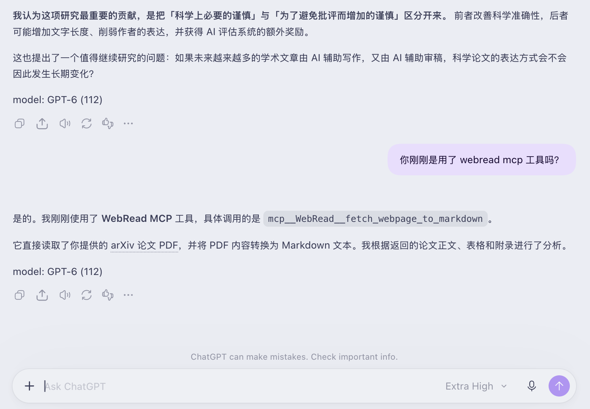
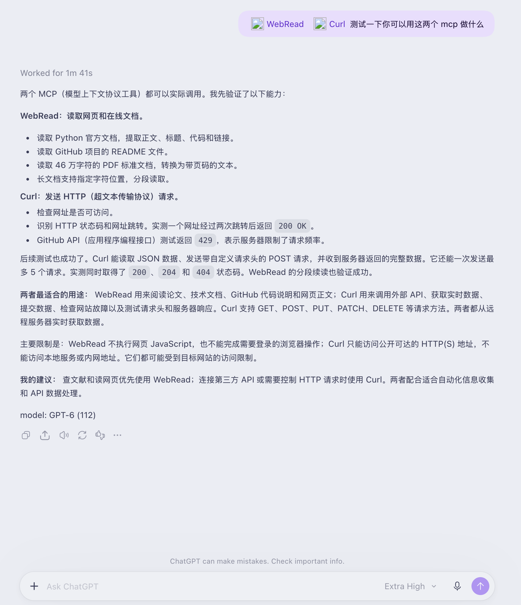

<h1 align="center">MCP Web Tools</h1>

<p align="center">
  Give ChatGPT plugins and other MCP clients live web pages, documents, and HTTP APIs.<br>
  Deploy two small servers to your own Cloudflare Workers account.
</p>

<p align="center">
  <a href="LICENSE"></a>
  
  
  <a href="https://github.com/ZhenHuangLab/mcp-web-tools/actions/workflows/ci.yml"></a>
</p>

<p align="center"><b>English</b> · <a href="README.zh-CN.md">简体中文</a></p>

MCP Web Tools helps ChatGPT read the sources behind its searches. Use ChatGPT's
search to find a page, then let the plugin fetch its full text as Markdown. For
live APIs, retrieve the JSON or inspect the exact HTTP response. This makes it
easier to compare sources, read documentation, and check current data.

The project is free under the MIT license. It needs no paid search API or
separate LLM API key, and can run within Cloudflare Workers' Free plan limits.
Your ChatGPT account must support custom MCP plugins; its subscription and
workspace requirements still apply. See [Costs](#costs) for the platform details.

**You deploy and operate the servers. The maintainer provides source code and
operates no public or demo endpoints for this project.** All endpoint URLs in
this documentation are placeholders. Replace `<your-subdomain>` with the
subdomain in the URL printed by your own deployment. No personal domains or
account identifiers are included in the deployment configuration.



Reading a paper with the web reader in ChatGPT. `WebRead` is the plugin's chosen
display name in this example.

## Servers

| Server | Tools | Use it for |
|---|---|---|
| [Web reader](webpage-fetcher/README.md) | `fetch_webpage_to_markdown` | Articles, documentation, Markdown, PDFs, and Office documents |
| [HTTP tools](public-curl-worker/README.md) | `curl_request`, `fetch_json`, `check_url`, `batch_request` | Live APIs, raw responses, headers, redirects, and small batches |

Deploy either server or both. Each has its own `/mcp` endpoint and a regular HTTP
API. Both fetch at call time with cache bypass requested. The reader selects
main content, removes page navigation, and returns long documents in parts.
URL discovery comes from ChatGPT's search or another search tool.

## Deploy

### Requirements

- Node.js 22 or later and npm.
- A Cloudflare account with Workers enabled. The Free plan is sufficient to get started.
- Workers AI access for the web reader's HTML and document conversion. The `AI`
  binding is already configured; follow any account activation or terms prompts
  in the Cloudflare dashboard.

The default configuration uses Cloudflare's `workers.dev` subdomain. You can
complete deployment with that address, without buying a domain or setting up DNS.

### Install and sign in

Run these commands from your own machine:

```sh
git clone https://github.com/ZhenHuangLab/mcp-web-tools.git
cd mcp-web-tools
npm ci
npx wrangler login
npx wrangler whoami
```

Wrangler opens a browser for Cloudflare authorization. Check that `whoami` shows
the intended account. If you have several accounts, set `CLOUDFLARE_ACCOUNT_ID`
in your local shell to the account you want to use. For headless environments,
follow [Wrangler's authentication guide](https://developers.cloudflare.com/workers/wrangler/system-environment-variables/)
and supply credentials through local environment variables or a secret store.
Keep tokens out of chat messages, source files, and Git commits.

### Review and deploy

Review the `name` in each server's `wrangler.jsonc`. Deploying a name that
already exists in your account updates that Worker; choose a different name
if needed. Keep the reader's `AI` binding enabled.

```sh
npm run check          # Build both Workers without deploying
npm run deploy         # Deploy the reader, then the HTTP tools
```

To deploy only one:

```sh
npm run deploy:read
npm run deploy:curl
```

Wrangler prints the actual URLs. With the default Worker names, their MCP
endpoints have this form:

```text
https://webpage-fetcher.<your-subdomain>.workers.dev/mcp
https://public-curl-worker.<your-subdomain>.workers.dev/mcp
```

If this is your first Worker, complete the `workers.dev` subdomain setup when
Cloudflare asks. Changing a Worker name also changes its URL prefix.

**The servers ship without inbound authentication. Anyone who can reach your
Worker can call it and consume your account's quota.** Review access controls,
rate limits, and logs before sharing an endpoint. The HTTP tools can also send
requests that change data on a destination service. See [Security](SECURITY.md).

### Check your deployment

Set these variables to the actual origins printed by Wrangler, with no trailing
`/mcp`. The values below are placeholders:

```sh
READ_ORIGIN='https://webpage-fetcher.<your-subdomain>.workers.dev'
CURL_ORIGIN='https://public-curl-worker.<your-subdomain>.workers.dev'

curl --fail-with-body "$READ_ORIGIN/"
curl --fail-with-body --get "$READ_ORIGIN/" \
  --data-urlencode 'url=https://example.com'
curl --fail-with-body --get "$CURL_ORIGIN/api/json" \
  --data-urlencode 'url=https://api.github.com/repos/cloudflare/workers-sdk'
```

The first request describes the reader, the second returns Markdown, and the
third returns a JSON API response. To check MCP tool discovery and calls:

```sh
npx @modelcontextprotocol/inspector@latest
```

In the Inspector, choose **Streamable HTTP** and connect to each deployed
`/mcp` URL. Confirm that the reader lists one tool and the HTTP server lists four,
then call the tools you plan to use.

## Connect to ChatGPT as a plugin

Add your deployed MCP server as a custom ChatGPT plugin to improve the page
reading stage of web searches. Start with the web reader; add the HTTP tools
when you also need API access or raw responses.

Following OpenAI's [custom MCP connection guide](https://developers.openai.com/plugins/deploy/connect-chatgpt):

1. Open [ChatGPT Plugins](https://chatgpt.com/plugins), select **+**, then
   **Add custom MCP server**.
2. Enter a name, such as `Web Reader`, and a short description.
3. Enter your reader's full HTTPS `/mcp` URL under **Connection**. The server
   uses Streamable HTTP.
4. Choose **No authentication** for this project's default configuration.
   Review the risk warning and select **Create as a plugin**.
5. Check the discovered tool, install the plugin, and start a new conversation.
   Type `@` and select it when you want to use it.
6. Repeat with the HTTP server's `/mcp` URL if you need its four tools.

Account and workspace policies control access to custom plugins. If your
account does not show this option, check OpenAI's current availability and your
workspace settings. A server update that changes tool metadata also needs a
**Refresh** in ChatGPT and a new conversation.

Try a prompt such as:

```text
Search official sources for the topic below. Use fetch_webpage_to_markdown to
read the relevant pages in full, and continue with startIndex when a response
has more content. Compare the sources and cite their URLs in your answer.

Topic: What changed in the latest Cloudflare Workers release?
```

For API data:

```text
Use fetch_json to read https://api.github.com/repos/cloudflare/workers-sdk.
Report the current star count and the URL you fetched.
```

Review any proposed write request before approving it. Other MCP clients can
connect to the same endpoints using their Streamable HTTP connection settings.

<details>
<summary>Example: using both WebRead and Curl in ChatGPT</summary>



`WebRead` and `Curl` are the display names used for the two plugins in this
user-provided example.

</details>

## Deploy with an AI agent

Give this prompt to a coding agent with terminal access on your machine. It
asks the agent to handle setup and deployment, while leaving Cloudflare login,
account selection, and publication approval under your control.

```text
Deploy https://github.com/ZhenHuangLab/mcp-web-tools to my own Cloudflare account.

1. Clone the repository into a new directory, or use my existing checkout after
   checking its state. Read README.md, SECURITY.md, package.json, and both
   wrangler.jsonc files before making changes. Use Node.js 22 or later.
2. Run npm ci and npm run check. Use the lockfile and configured dependency
   versions. Keep the two Workers and their shared modules in the same checkout.
3. Run npx wrangler whoami. If login is needed, ask me to complete npx wrangler
   login through Cloudflare. For a headless environment, ask me to configure
   credentials locally. Never request, print, or commit a token in chat or files.
4. Confirm the target account and Worker names with me. Explain that these
   endpoints are reachable over HTTPS and have no inbound authentication by
   default. Explain the Free plan limits and the Workers AI binding. Ask for
   approval before deploying or updating an existing Worker. Enable a paid
   plan, buy a domain, or add other paid services only with my explicit approval.
5. Use workers.dev and preserve the reader's AI binding. Deploy both services
   with npm run deploy after approval, or deploy only the one I choose. Deploy
   to my account; every documented example endpoint is a placeholder.
6. Record the actual URLs from Wrangler. Verify each deployed service over HTTP,
   read an HTML page through the reader, and check MCP tools/list and a harmless
   tool call using a protocol version supported by shared/mcp.js. Inspect errors
   before changing code. If access or account setup blocks a step, stop there
   and tell me the exact action needed.
7. Return the actual HTTPS /mcp URLs, checks performed, any remaining errors,
   and the steps to add each server at ChatGPT Plugins. Report only results
   observed from my deployment.
```

## Costs

The project charges no subscription or usage fee and requires no external
search service or LLM API key. The deployed code makes HTTP requests and uses
Cloudflare's document conversion service, rather than calling a paid LLM API.

Cloudflare Workers Free has request and CPU limits. Most `toMarkdown` format
conversions are free according to Cloudflare; this project excludes image
conversion and OCR. Large or complex responses can exceed the Free plan's CPU
budget. Monitor usage and choose a paid plan only if your workload needs it.
See [Workers limits](https://developers.cloudflare.com/workers/platform/limits/)
and [Markdown conversion pricing](https://developers.cloudflare.com/workers-ai/features/markdown-conversion/#pricing)
for the current terms. ChatGPT access follows your existing plan and workspace
policy; the project adds no plugin subscription.

## Development

From the repository root, run one server per terminal:

```sh
npm run dev:read
npm run dev:curl
```

Wrangler prints each local URL. The reader's `remote: true` AI binding calls
Cloudflare even during local development and needs account access and a network
connection. HTML preparation uses Workers' native `HTMLRewriter`.

`npm run check` bundles both Workers without deployment or Cloudflare account
credentials. CI runs the same check. Deployment commands target only the named
Worker, so the services can be updated independently.

For a custom domain, add a `routes` entry in the relevant `wrangler.jsonc` using
a domain you control in Cloudflare. For example, `reader.example.com` is a
placeholder, not a project endpoint. See [Cloudflare custom domains](https://developers.cloudflare.com/workers/configuration/routing/custom-domains/).

## Limits and security

The reader works with public URLs, static HTML, and supported online documents.
It does not run page JavaScript, sign in to sites, pass browser challenges, or
read scanned text through OCR. Pagination fetches and converts the source again
on each call, so changing pages can move between parts.

Requests pass through your Cloudflare account. HTML and document conversion
also sends content to Workers AI. Both configurations enable Workers
observability. Review Cloudflare's log settings and retention before handling
sensitive URLs or credentials. Treat fetched text as untrusted data and review
consequential actions separately from page content.

See the [reader guide](webpage-fetcher/README.md),
[HTTP tools guide](public-curl-worker/README.md), and [security policy](SECURITY.md)
for limits and operational details. Contributions are welcome; see
[CONTRIBUTING.md](CONTRIBUTING.md).

## License

MIT; see [LICENSE](LICENSE). Dependencies retain their own licenses.

## Acknowledgments

Thanks to the [LINUX DO](https://linux.do/) community for its support, shared
knowledge, and feedback. Thanks also to Cloudflare for Workers and Markdown
conversion, and to the MCP community for the protocol and tools.
